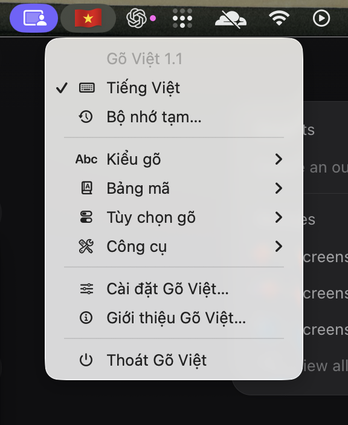
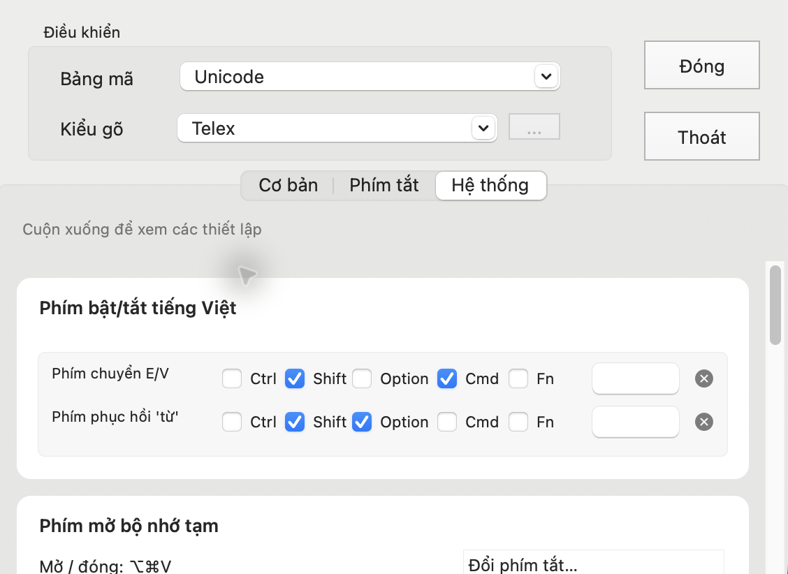

# Gõ Việt

Bộ gõ tiếng Việt dành cho macOS, dựa trên phần lõi **EVKey 3.3.8** của **Lâm Quang Minh**.

**Phiên bản 1.1**

**Nổi bật: biểu tượng chuyển động trên menu bar và bảng bộ nhớ tạm.**

[Tải Gõ Việt 1.1 cho macOS](https://github.com/bvd0101/Go-Viet/releases/download/v1.1/Go-Viet-1.1.dmg)

- **Menu bar có chuyển động:** cờ đỏ sao vàng bay khi bật tiếng Việt, khủng long chạy khi tắt; có công tắc tắt cả hai hoạt ảnh.
- **Bộ nhớ tạm tiện dụng:** lưu đến 50 mục văn bản/ảnh, tìm kiếm, xem ảnh thu nhỏ và chép lại nhanh bằng **⌥⌘V**; bảng dùng nền Liquid Glass.


Gõ Việt bổ sung bảng nhớ tạm, nền Liquid Glass trên macOS 26, biểu tượng trạng thái và các thiết lập tập trung trong thẻ **Hệ thống**. Đây là bản tùy chỉnh không chính thức, không phải phiên bản do tác giả EVKey phát hành.

## Xem trực tiếp

### GIF biểu tượng cờ bay


Đây là hình động, xuất từ các khung vẽ biểu tượng của app.

### Menu trên thanh trạng thái



### Cài đặt bộ gõ và bộ nhớ tạm



## Yêu cầu

- **macOS 26** để sử dụng Liquid Glass. Môi trường phát triển và kiểm tra là macOS 26.7.3.
- Quyền **Trợ năng / Accessibility** để xử lý bàn phím.

## Cài đặt

1. [Tải Gõ Việt 1.1](https://github.com/bvd0101/Go-Viet/releases/download/v1.1/Go-Viet-1.1.dmg) từ mục **Releases**.
2. Thoát EVKey hoặc bản Gõ Việt đang chạy. Giữ một bản sao cũ nếu muốn quay lại.
3. Mở DMG, kéo **Gõ Việt.app** vào **Applications**.
4. Mở app từ Applications.
5. Vào **System Settings → Privacy & Security → Accessibility**, thêm và bật quyền cho đúng app trong Applications.
6. Chọn nguồn bàn phím **ABC** khi dùng Gõ Việt. Chỉ chạy một bộ gõ cùng lúc.

App được ký cục bộ, chưa được Apple công chứng. Nếu macOS chặn mở, xem nút **Open Anyway** trong Privacy & Security nếu có. Không cần tắt SIP hoặc Gatekeeper toàn hệ thống.

Sau khi thay phiên bản, nếu app không gõ được, thử xóa mục Trợ năng cũ rồi thêm lại đúng app đang cài.

## Cách sử dụng

Biểu tượng trên thanh menu cho biết trạng thái:

| Trạng thái | Biểu tượng |
| --- | --- |
| Bật tiếng Việt | Cờ đỏ sao vàng |
| Tắt tiếng Việt | Khủng long |

Trong **Hệ thống**, tùy chọn **Bật chuyển động cờ và khủng long** điều khiển cả hai hiệu ứng:

- **Bật:** cờ bay khi dùng tiếng Việt; khủng long chạy khi tắt tiếng Việt.
- **Tắt:** cả hai đứng yên.

Hiệu ứng cũng dừng khi máy ngủ, phiên làm việc không hoạt động hoặc macOS bật **Reduce Motion**.

## Cài đặt ở đâu?

Mở bảng điều khiển, chọn thẻ **Hệ thống**. Các thiết lập được chia thành từng phần; cuộn để xem các mục phía dưới. Không mở thêm cửa sổ cài đặt riêng.

| Phần | Nội dung |
| --- | --- |
| **Phím bật/tắt tiếng Việt** | Phím chuyển E/V và phím phục hồi từ; sử dụng các điều khiển gốc của bộ gõ. |
| **Phím mở bộ nhớ tạm** | Đổi tổ hợp mở/đóng bảng nhớ tạm. |
| **Nền kính và chuyển động** | Độ trong của Liquid Glass; bật/tắt chuyển động cờ và khủng long. |
| **Lưu lịch sử sao chép** | Bật/tạm dừng ghi, lưu sau khi thoát, xóa lịch sử. |
| **Tương thích bàn phím** | Giãn thời gian gửi dấu và kiểm tra kết nối bàn phím. |
| **Hệ thống bộ gõ** | Những thiết lập hệ thống gốc của EVKey. |

Thanh bên chỉ hiển thị thông tin bộ gõ, tác giả và liên kết nguồn.

### Đổi phím bật/tắt tiếng Việt

Trong **Hệ thống → Phím bật/tắt tiếng Việt**, chỉnh hàng **Phím chuyển E/V**. Có thể chọn các phím bổ trợ và phím ký tự; nút xóa bên cạnh bỏ phím ký tự đã chọn.

Nếu đang dùng **⌘ + Shift**, cấu hình đó được giữ lại. Để dùng tổ hợp chỉ gồm hai phím này, chọn **Cmd**, **Shift** và bỏ phím ký tự trong hàng E/V.

Phím bật/tắt tiếng Việt và phím mở bộ nhớ tạm là **hai thiết lập riêng**.

### Bộ nhớ tạm

- Mặc định **⌥⌘V** mở hoặc đóng bảng; **Esc** cũng đóng bảng.
- Dùng **↑ / ↓** để chọn mục.
- Nhấn **Enter**, nhấp đúp hoặc bấm **Chép lại** để đưa mục đã chọn về clipboard.
- Sau đó dùng **⌘V** ở nơi muốn dán.
- Có tìm kiếm, thời gian sao chép và ảnh thu nhỏ.
- Nút thùng rác xóa mục đang chọn. **Xóa toàn bộ…** nằm trong Hệ thống.
- Nút cài đặt trên bảng nhớ tạm mở thẳng thẻ **Hệ thống**, không tạo cửa sổ mới.

Để đổi tổ hợp mở bảng, vào **Hệ thống → Phím mở bộ nhớ tạm**, bấm **Đổi phím tắt…**, rồi nhấn tổ hợp mới. Tổ hợp phải có Command, Control hoặc Option. Esc hủy thao tác ghi phím.

### Liquid Glass

Trong **Hệ thống → Nền kính và chuyển động**, chỉnh **Độ trong nền kính** từ 0–100%.

Thiết lập này thay đổi lớp kính nền, không giảm độ rõ của chữ và biểu tượng. App sử dụng `NSGlassEffectView` của macOS 26. Hiển thị thực tế còn phụ thuộc giao diện và thiết lập trợ năng của hệ thống.

## Bộ nhớ và dữ liệu clipboard

- Tối đa **50 mục**, với khoảng **8 MB dữ liệu lịch sử**. Đây không phải giới hạn tổng RAM của app.
- Văn bản tối đa khoảng **256 KB/mục**; PNG tối đa khoảng **3 MB/mục**.
- Ảnh TIFF được thu về cạnh dài tối đa 2048 pixel trước khi lưu PNG.
- Danh sách chỉ giải mã ảnh thu nhỏ và tái sử dụng các ô hiển thị.
- Đóng bảng nhớ tạm sẽ giải phóng phần giao diện bảng.
- Một công tắc chuyển động chung giúp tắt cả hoạt ảnh cờ và khủng long.

**Ghi lịch sử mới** bật mặc định; **giữ lịch sử sau khi thoát** tắt mặc định.

Khi bật giữ lịch sử, dữ liệu được lưu cục bộ tại:

```text
~/Library/Application Support/GoViet/history.plist
```

Tệp này không được mã hóa riêng. Bỏ chọn giữ lịch sử sẽ xóa tệp lịch sử đã lưu, nhưng không xóa clipboard hiện tại. Tính năng lịch sử không tải nội dung lên máy chủ.

App bỏ qua nội dung được ứng dụng nguồn đánh dấu concealed, transient hoặc password. Điều này không thể nhận biết mọi dữ liệu nhạy cảm nếu ứng dụng nguồn không đánh dấu. Không hỗ trợ lịch sử tệp tin; các mục quá lớn có thể không được lưu.

## Khi gõ bị mất dấu

Trước tiên, kiểm tra quyền Trợ năng, nguồn bàn phím ABC và việc chỉ chạy một bộ gõ.

Trong **Hệ thống → Tương thích bàn phím**:

- **Giãn thời gian gửi dấu:** 0–5 ms, mặc định 0 giữ thời gian gửi phím gốc. Tăng có thể làm gõ chậm hơn; đây không phải điều chỉnh độ nhạy phần cứng.
- **Kiểm tra kết nối bàn phím:** kiểm tra các kết nối do phần lõi tạo và hiển thị số lần khôi phục trong phiên.

App có kiểm tra dự phòng để bật lại kết nối hợp lệ khi phần lõi vẫn yêu cầu kết nối đó hoạt động. Cơ chế này tôn trọng việc phần lõi chủ động tắt kết nối và trạng thái nghỉ của phiên làm việc.

**Chưa xác nhận khắc phục dứt điểm lỗi mất dấu hoặc trường hợp biểu tượng vẫn báo V nhưng không gõ được tiếng Việt.** Chưa có kiểm chứng ổn định dài hạn trên mọi ứng dụng. Khi báo lỗi, hãy kèm phiên bản macOS, ứng dụng đang dùng, kiểu gõ và ví dụ chuỗi gõ → kết quả.

## Quay lại bản cũ

Thoát Gõ Việt, thay app trong Applications bằng bản sao lưu. Cấp lại quyền Trợ năng nếu cần.

Gõ Việt sử dụng định danh và thiết lập của EVKey để tương thích phần lõi; hai app có thể dùng chung cấu hình. Không chạy đồng thời.

## Tác giả và nguồn

- Phần lõi EVKey: **Lâm Quang Minh** — [kho EVKey gốc](https://github.com/lamquangminh/EVKey).
- Hướng xử lý vòng lặp khởi động tham khảo: [bản vá cộng đồng cho macOS 26](https://github.com/phanbaohuy96/EVKey/releases/tag/v3.3.8-macos26.1).

Phần tùy chỉnh không đại diện cho mã nguồn đầy đủ của EVKey. Giữ ghi công và bản quyền của tác giả gốc.
